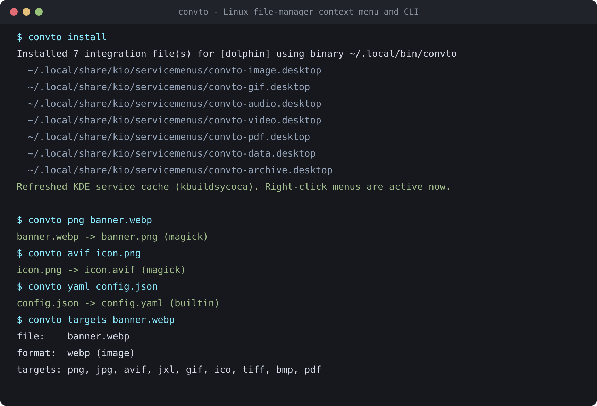

# convto

Zero-dependency Rust CLI and Linux file-manager context menu ("Convert to" and "Shrink / Optimize...") for converting and size-optimizing images, GIFs, audio, video, PDFs, structured data, archives, and documents from a right-click or terminal.



## What it does

Right-click one or more files in your Linux file manager, hover **Convert to**, and either pick a target format or click **Shrink / Optimize...** to reduce file size while keeping the highest quality that fits your budget. `convto` writes outputs atomically beside the source file without overwriting originals (`photo.png`, then `photo (1).png`; `clip-shrunk.mp4` for shrinking), converts multi-file selections in parallel, and sends a desktop notification via `notify-send`.

Key details:
- Single ~685 KB stripped binary (`#![forbid(unsafe_code)]`, zero external crates).
- Interactive Shrink & Optimize dialog (native GTK4 / Libadwaita with `kdialog`/`zenity` fallback) with three modes: exact Target Size (`10 MB`, `500 KB`, Discord/Email presets), Size % Wheel (slider + scroll-wheel spinbox targeting a percentage of original bytes), and Quality Wheel (`10%` to `100%` + lossless-only toggle), plus a collapsible Advanced drawer.
- Binary-search image quality solver (JPEG, WebP, AVIF, JXL, plus lossless and quantized PNG) that finds the highest quality fitting under your byte limit, with automatic gentle scaling only if needed.
- Two-pass exact-bitrate video and audio shrinking via `ffprobe` + `ffmpeg` (H.264, H.265/HEVC, VP9 WebM, Opus, MP3, M4A) and tiered-DPI Ghostscript PDF shrinking that preserves vector text.
- Magic-byte sniffing catches misnamed files (for example, WebP bytes saved with a `.jpg` extension still convert properly instead of skipping as already JPEG).
- Disjoint MIME menus so Dolphin shows one **Convert to** submenu per file type, only installing groups whose backends exist on your machine.
- Built-in structured data converter (`json`, `yaml`, `toml`, `csv`, `tsv`) with no external dependencies.
- Archive repacking validates member paths against directory traversal (`..` and absolute paths) before extraction.

## Supported formats

| Family | Inputs | Targets | Backend |
| --- | --- | --- | --- |
| Images | `png`, `jpg`, `webp`, `avif`, `heic`, `jxl`, `bmp`, `tiff`, `ico`, `svg`, `tga`, `psd`, `qoi`, `ppm` | `png`, `jpg`, `webp`, `avif`, `jxl`, `gif`, `ico`, `tiff`, `bmp`, `pdf` | `magick` / `convert`, `rsvg-convert` |
| GIF | `gif` | `mp4`, `webm`, `webp`, `png`, `jpg`, `avif` | `ffmpeg`, `magick` |
| Audio | `mp3`, `wav`, `flac`, `ogg`, `opus`, `m4a`, `aac`, `wma`, `aiff`, `mka` | `mp3`, `wav`, `flac`, `ogg`, `opus`, `m4a` | `ffmpeg` |
| Video | `mp4`, `mkv`, `webm`, `mov`, `avi`, `flv`, `wmv`, `mpg`, `3gp` | `mp4`, `mkv`, `webm`, `mov`, `gif`, `mp3`, `wav`, `opus` | `ffmpeg` |
| PDF | `pdf` | `png`, `jpg`, `webp`, `txt` | `pdftoppm`, `pdftotext` |
| Data | `json`, `yaml`, `toml`, `csv`, `tsv` | `json`, `yaml`, `toml`, `csv`, `tsv` | Built-in |
| Archives | `zip`, `tar`, `tar.gz`, `tar.zst`, `tar.xz`, `tar.bz2`, `7z`, `rar` | `zip`, `tar.gz`, `tar.zst`, `tar.xz`, `tar.bz2`, `tar`, `7z` | `tar`, `bsdtar`, `7z`, `zstd` |
| Documents | `md`, `html`, `docx`, `odt`, `epub`, `rtf` | `pdf`, `html`, `md`, `docx`, `odt`, `txt` | `pandoc`, `libreoffice` |

## Install

Build and install the binary plus your desktop right-click menus:

```bash
cargo build --release
install -Dm755 target/release/convto ~/.local/bin/convto
convto install
```

Supported file managers (auto-detected by `convto install`, or pass `--desktop dolphin|nautilus|nemo|thunar|all`):

- KDE Dolphin (Plasma 6 and 5): `~/.local/share/kio/servicemenus/convto-*.desktop` (auto-runs `kbuildsycoca6`).
- GNOME Files (Nautilus): `~/.local/share/nautilus-python/extensions/convto_nautilus.py` (requires `python-nautilus` / `nautilus-python`; restart Nautilus with `nautilus -q`).
- Cinnamon Nemo: `~/.local/share/nemo/actions/convto-*.nemo_action`.
- XFCE Thunar: managed `<!-- convto-managed -->` entries in `~/.config/Thunar/uca.xml`.

Remove all generated menus cleanly at any time without affecting your other custom actions:

```bash
convto uninstall
```

## CLI usage

```bash
# Convert images (single or batch)
convto png photo.webp
convto webp *.png -q 85

# Convert animated GIFs, video, or extract audio
convto mp4 reaction.gif
convto gif clip.mp4
convto mp3 lecture.mkv

# Render PDF pages or extract text
convto png slides.pdf
convto txt paper.pdf

# Convert config and table formats (built-in, no external tools)
convto yaml config.json
convto toml config.yaml
convto tsv export.csv

# Repack archives safely
convto tar.zst backup.zip

# Shrink while preserving maximum quality (exact target size, size %, quality wheel, or GUI)
convto shrink clip.mp4 --target-size 10MB
convto shrink photo.png --percent 45 --to webp
convto shrink report.pdf --target-size 2MB
convto shrink photo.jpg --lossless
convto shrink --gui photo.png clip.mp4

# Inspect detected format, valid targets, and installed backends
convto targets photo.webp
convto doctor
```

Useful convert flags: `--out-dir <dir>`, `--overwrite`, `--force` (re-encode same format), `--delete-source`, `--quality <1-100>`, `--jobs <n>`, `--dry-run`, `--notify`.

Useful shrink flags: `--target-size <size>`, `--percent <1-99>`, `--quality <1-100>`, `--lossless`, `--to <fmt>`, `--hevc`, `--max-dim <px>`, `--preset fast|medium|slow`, `--no-two-pass`, `--keep-metadata`, `--in-place`, `--gui`, `--json`.

## Limitations

- Media, PDF, archive, and document conversions shell out to system tools (`magick`, `ffmpeg`, `pdftoppm`, `tar`/`7z`, `pandoc`/`libreoffice`). Run `convto doctor` to see what is installed on your machine.
- In KDE Dolphin, KIO service menus filter by MIME family rather than hiding the current file's own format inside the submenu (so `PNG (.png)` still appears when right-clicking a `.png`, and `convto` skips it cleanly unless `--force` is passed). Nautilus's Python extension hides the active format dynamically.
- The built-in YAML parser covers standard block/flow mappings, sequences, and scalars; it does not implement anchors/aliases (`&a`/`*a`), multi-document streams, or custom tags.
- Focused on Linux desktops; the CLI works on macOS too, while file-manager menu installation targets Linux file managers.

## License

MIT. See [LICENSE](LICENSE).
